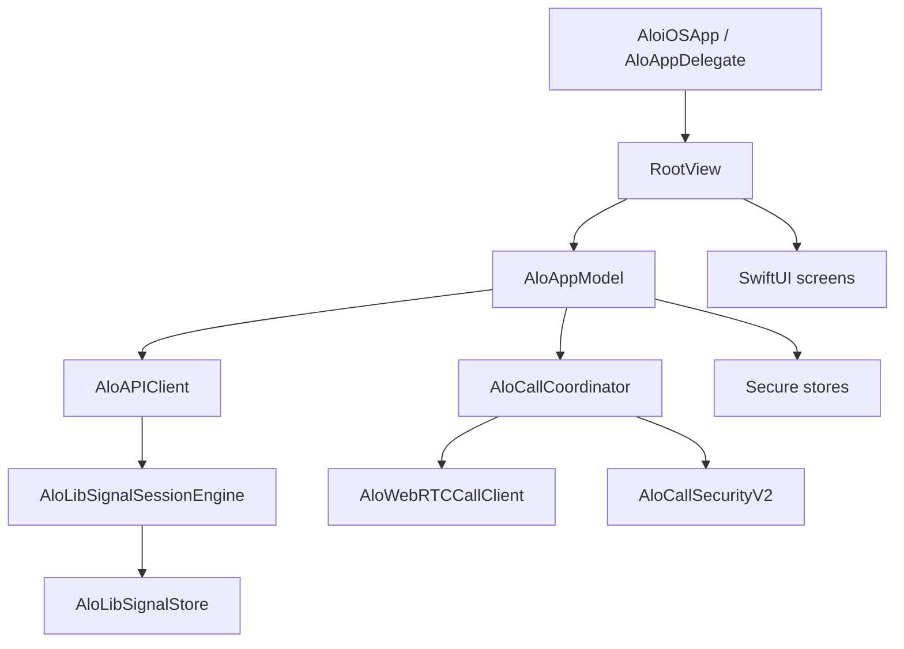

# Архитектура и классы AloiOS

Этот документ описывает ответственность исходных типов iOS-клиента. Проект
использует SwiftUI и близкую к MVVM архитектуру: представления отображают
состояние, `AloAppModel` управляет пользовательскими сценариями, а
`AloAPIClient`, защищённые хранилища и подсистема звонков выполняют
инфраструктурную работу.

## Точка входа и push

| Тип | Файл | Назначение |
| --- | --- | --- |
| `AloiOSApp` | `AloiOS/AloiOSApp.swift` | Точка входа SwiftUI. Создаёт модель приложения, подключает app delegate и корневой экран. |
| `AloAppDelegate` | `AloiOS/App/AloPushCoordinator.swift` | Связывает жизненный цикл UIKit, APNs, уведомления и запуск приложения из push. |
| `AloPushCoordinator` | `AloiOS/App/AloPushCoordinator.swift` | Регистрирует обычный APNs-токен на сервере и удаляет устаревшую регистрацию. |
| `AloVoIPPushCoordinator` | `AloiOS/App/AloPushCoordinator.swift` | Управляет PushKit-токеном и передаёт входящие VoIP push в подсистему звонков. |
| `AloPushAvailability` | `AloiOS/App/AloPushCoordinator.swift` | Определяет, доступны ли push-возможности в текущей сборке и среде. |

## Состояние приложения

| Тип | Файл | Назначение |
| --- | --- | --- |
| `AloAppModel` | `AloiOS/ViewModels/AloAppModel.swift` | Главный `ObservableObject` и единый источник состояния. Выполняет авторизацию, загрузку bootstrap, синхронизацию ленты и чатов, offline-операции, реакции, профиль и настройки. |
| `AloAppModel.Phase` | `AloiOS/ViewModels/AloAppModel.swift` | Состояние запуска: загрузка, авторизация или основное приложение. |
| `AloAppModel.AuthMode` | `AloiOS/ViewModels/AloAppModel.swift` | Переключает вход и регистрацию. |
| `AloAppModel.HumanChallenge` | `AloiOS/ViewModels/AloAppModel.swift` | Описывает действие, которое сервер потребовал подтвердить через Turnstile. |
| `PendingChatOperation` | `AloiOS/ViewModels/AloAppModel.swift` | Локальная команда чата, ожидающая сеть: отправка, изменение, удаление или реакция. |
| `AloPendingChatProjection` | `AloiOS/Storage/AloPendingChatProjection.swift` | Накладывает локальные ожидающие операции на серверную историю, чтобы сообщения не исчезали при повторном входе в чат. |

## Сеть и окружение

| Тип | Файл | Назначение |
| --- | --- | --- |
| `AloAPIClient` | `AloiOS/Networking/AloAPIClient.swift` | Типизированная точка доступа ко всему HTTP API, event stream, загрузкам, E2EE-конвертам, push и signaling звонков. |
| `AloAPIError` | `AloiOS/Networking/AloAPIClient.swift` | Ошибка API со статусом HTTP, машинным кодом, текстом и исходным payload. |
| `AloMessageSendAcknowledgement` | `AloiOS/Networking/AloAPIClient.swift` | Подтверждение сервером отправленного сообщения. |
| `AloChatStreamEvent` | `AloiOS/Networking/AloAPIClient.swift` | Одно событие cursor-stream чатов. |
| `AloSafetyDevice` | `AloiOS/Networking/AloAPIClient.swift` | Устройство собеседника, показанное на экране проверки ключей. |
| `AloSafetyVerification` | `AloiOS/Networking/AloAPIClient.swift` | Safety number и набор устройств для ручной сверки E2EE. |
| `AloEnvironment` | `AloiOS/Networking/AloAPIClient.swift` | Читает URL API и certificate pins из build settings; release-конфигурация запрещает небезопасный транспорт. |
| `AloCertificatePinningDelegate` | `AloiOS/Networking/AloCertificatePinningDelegate.swift` | Проверяет TLS trust и SHA-256 pins сертификатов production API. |

## E2EE и локальная криптография

| Тип | Файл | Назначение |
| --- | --- | --- |
| `AloLibSignalSessionEngine` | `AloiOS/Networking/AloLibSignalSessionEngine.swift` | Создаёт и использует libsignal-сессии, шифрует и расшифровывает сообщения, обрабатывает prekey bundles. |
| `AloLibSignalStore` | `AloiOS/Storage/AloLibSignalStore.swift` | Реализует хранилища identity keys, prekeys, signed prekeys, sender keys и session records для libsignal. Секреты защищены Keychain. |
| `AloLibSignalStoreContext` | `AloiOS/Storage/AloLibSignalStore.swift` | Контекст, который связывает Swift-реализацию хранилищ с API `LibSignalClient`. |
| `AloLibSignalSelfTest` | `AloiOS/Networking/AloLibSignalSelfTest.swift` | Проверяет локальный crypto round-trip и совместимость при запуске/тестировании. |
| `AloLibSignalPreKeyBundle` | `AloiOS/Networking/AloLibSignalSessionEngine.swift` | Публичный набор ключей устройства для начала новой сессии. |
| `AloLibSignalCiphertext` | `AloiOS/Networking/AloLibSignalSessionEngine.swift` | Сериализованный результат шифрования libsignal. |
| `AloLibSignalOneTimePreKey` | `AloiOS/Networking/AloLibSignalSessionEngine.swift` | Одноразовый prekey устройства. |
| `AloLibSignalDeviceBundle` | `AloiOS/Networking/AloLibSignalSessionEngine.swift` | Полное публичное описание удалённого устройства. |

## Защищённые локальные данные

| Тип | Файл | Назначение |
| --- | --- | --- |
| `AloSecureOutboxStore` | `AloiOS/Storage/AloSecureOutboxStore.swift` | Шифрует и сохраняет очередь исходящих сообщений и команд до подтверждения сервером. |
| `AloSecureOfflineCacheStore` | `AloiOS/Storage/AloSecureOfflineCacheStore.swift` | Хранит зашифрованный bootstrap и историю для просмотра без сети. |
| `AloSecureMediaStore` | `AloiOS/Storage/AloSecureMediaStore.swift` | Загружает зашифрованные вложения, хранит ciphertext на диске и расшифровывает данные в памяти. |
| `AloSecureMediaStore.Payload` | `AloiOS/Storage/AloSecureMediaStore.swift` | Расшифрованные байты и MIME-метаданные одного вложения. |
| `AloAsyncImage` | `AloiOS/Storage/AloSecureMediaStore.swift` | SwiftUI-обёртка для безопасной асинхронной загрузки изображений. |
| `AloAsyncImagePhase` | `AloiOS/Storage/AloSecureMediaStore.swift` | Состояние безопасного изображения: пусто, готово или ошибка. |
| `AloImageCache` | `AloiOS/Storage/AloSecureMediaStore.swift` | Общий memory cache декодированных изображений. |

## Звонки

| Тип | Файл | Назначение |
| --- | --- | --- |
| `AloCallCoordinator` | `AloiOS/Calls/AloCallCoordinator.swift` | Оркестратор звонка. Управляет серверной сессией, CallKit, WebRTC, E2EE handshake, reconnect, звуками, камерой и демонстрацией экрана. |
| `AloWebRTCCallClient` | `AloiOS/Calls/AloWebRTCCallClient.swift` | Низкоуровневый WebRTC-клиент: peer connection, SDP/ICE, аудио, камеры, renderer и ReplayKit capture. |
| `AloCallSecurityHandshake` | `AloiOS/Calls/AloCallSecurityV2.swift` | Изменяемое состояние одноразового X25519 handshake конкретного звонка. |
| `AloCallSecurityV2` | `AloiOS/Calls/AloCallSecurityV2.swift` | Commitment, transcript, общий call secret, взаимные подтверждения и safety emoji. |
| `AloCallSecurityV2KeyPair` | `AloiOS/Calls/AloCallSecurityV2.swift` | Одноразовая пара X25519-ключей звонка. |
| `AloCallTonePlayer` | `AloiOS/Calls/AloCallTonePlayer.swift` | Воспроизводит ringback, connecting, busy, no-answer и terminal tones. |
| `AloCallToneWaveform` | `AloiOS/Calls/AloCallTonePlayer.swift` | Генерирует локальные waveform-последовательности звуков звонка. |
| `AloCallOverlay` | `AloiOS/Calls/AloCallOverlay.swift` | Полноэкранный интерфейс звонка, жест сворачивания, видео, статусы и панель управления. |
| `AloCallCompactBar` | `AloiOS/Calls/AloCallOverlay.swift` | Компактная строка активного звонка у верхней safe area. |
| `AloCallVideoRenderer` | `AloiOS/Calls/AloCallOverlay.swift` | Встраивает `RTCMTLVideoView` в SwiftUI. |
| `AloCallVideoSourcePicker` | `AloiOS/Calls/AloCallVideoSourcePicker.swift` | Экран выбора задней камеры, передней камеры или трансляции экрана. |
| `AloCallVideoSource` | `AloiOS/Calls/AloCallVideoSourcePicker.swift` | Вариант источника видео. |
| `AloDirectCallState` | `AloiOS/Calls/AloCallModels.swift` | Полное UI-состояние текущего звонка. |
| `AloDirectCallPhase` | `AloiOS/Calls/AloCallModels.swift` | Фаза вызова: ringing, connecting, connected, reconnecting или terminal. |
| `AloDirectCallSession` | `AloiOS/Calls/AloCallModels.swift` | Серверная сессия прямого звонка. |
| `AloDirectCallPeer` | `AloiOS/Calls/AloCallModels.swift` | Минимальные данные собеседника. |
| `AloDirectCallSignal` | `AloiOS/Calls/AloCallModels.swift` | Расшифрованный signaling event. |
| `AloRTCConfiguration` | `AloiOS/Calls/AloCallModels.swift` | ICE/TURN-конфигурация WebRTC. |
| `AloRTCIceServer` | `AloiOS/Calls/AloCallModels.swift` | Один STUN/TURN server с credentials. |
| `AloCallVideoLayout` | `AloiOS/Calls/AloCallModels.swift` | Решает, показывать ли identity, local preview и remote video основным слоем. |
| `AloCallMinimizePolicy` | `AloiOS/Calls/AloCallModels.swift` | Порог и направление жеста сворачивания звонка. |
| `AloCallKitSupport` | `AloiOS/Calls/AloCallModels.swift` | Отключает недоступные возможности CallKit в симуляторе. |

## Доменные модели

Все модели находятся в `AloiOS/Models/AloModels.swift`.

| Тип | Назначение |
| --- | --- |
| `AloCurrentUser` | Авторизованный пользователь. |
| `AloEntitySummary` | Краткие данные пользователя, группы или канала. |
| `AloMediaItem` | Медиа поста. |
| `AloPost` / `AloPostComment` | Пост ленты и комментарий. |
| `AloConversationPeer` | Собеседник или группа в мессенджере. |
| `AloConversationSummary` | Строка списка чатов с последним сообщением и счётчиками. |
| `AloConversationDetail` | История, участники и метаданные открытого чата. |
| `AloChatMessage` | Сообщение, локальный статус, реакции, вложения и read state. |
| `AloMessageAttachment` / `AloLocalAttachment` | Серверное и локально выбранное вложение. |
| `AloMessageReaction` | Emoji-реакция и список поставивших её пользователей. |
| `AloForwardMeta` | Источник пересланного сообщения. |
| `AloGroupMember` | Участник группы и его роль. |
| `AloNotificationItem` | Уведомление приложения. |
| `AloUserProfile` | Полный профиль пользователя. |
| `AloProfileStats` / `AloProfileRelation` | Счётчики и отношения текущего пользователя с профилем. |
| `AloProfilePermissions` | Доступные действия над профилем. |
| `AloPrivacySettings` | Настройки приватности. |
| `AloNotificationSettings` | Настройки уведомлений. |
| `AloSecuritySession` | Авторизованное устройство/сессия аккаунта. |
| `AloBootstrapData` | Начальный снимок данных приложения. |
| `AloAppTab` / `AloFeedMode` | Выбранная вкладка и режим ленты. |
| `AloFormatters` | Общие форматтеры дат, времени и чисел. |

## Экраны и UI-компоненты

| Тип/группа | Файл | Назначение |
| --- | --- | --- |
| `RootView` | `AloiOS/Views/RootView.swift` | Выбирает skeleton, авторизацию или основное приложение; размещает глобальный call overlay. |
| `AuthView` | `AloiOS/Views/AuthView.swift` | Пошаговые вход, регистрация и подтверждение email. |
| `HumanChallengeView` | `AloiOS/Views/HumanChallengeView.swift` | Показывает Cloudflare Turnstile и возвращает проверенный token модели. |
| `MainTabView` | `AloiOS/Views/MainTabView.swift` | Нижняя навигация приложения. |
| `FeedView` / `CommentsSheet` | `AloiOS/Views/FeedView.swift` | Лента и комментарии к посту. |
| `MessagesView` | `AloiOS/Views/MessagesView.swift` | Список диалогов. |
| `ConversationView` | `AloiOS/Views/MessagesView.swift` | История чата, composer, клавиатура, медиа, реакции и контекстные действия. |
| `ChatAppearanceSheet` | `AloiOS/Views/MessagesView.swift` | Глобальные темы, обои и цвета чатов. |
| `ChatMessageRow` | `AloiOS/Views/MessagesView.swift` | Один bubble сообщения и его вложения/статусы. |
| `MessageActionOverlay` | `AloiOS/Views/MessagesView.swift` | Реакции и меню после долгого нажатия. |
| `MessageMediaGrid` / `ChatMediaViewer` | `AloiOS/Views/MessagesView.swift` | Альбом вложений и полноэкранный просмотр. |
| `VoiceMessageAttachmentView` / `CircleMessageAttachmentView` | `AloiOS/Views/MessagesView.swift` | Голосовые сообщения и видеокружки. |
| `ChatPeerInfoPanel` | `AloiOS/Views/MessagesView.swift` | Профиль личного/группового чата и его настройки. |
| `ChatSafetyNumberSheet` | `AloiOS/Views/MessagesView.swift` | Ручная сверка safety number и устройств. |
| `ProfileView` / `ProfileDetailView` | `AloiOS/Views/ProfileView.swift` | Собственный и чужой профиль, отношения, приватность и настройки. |
| `SearchView` | `AloiOS/Views/SearchView.swift` | Поиск людей и просмотр связей. |
| `AlertsView` | `AloiOS/Views/AlertsView.swift` | Список уведомлений. |
| `AloAvatar` | `AloiOS/Views/AloComponents.swift` | Аватар с memory cache и цветным fallback по имени. |
| `AloPostCard` / `AloPostMediaGrid` | `AloiOS/Views/AloComponents.swift` | Карточка поста и медиасетка. |
| `AloIconButton` / `AloPrimaryButton` / `AloTextField` | `AloiOS/Views/AloComponents.swift` | Переиспользуемые базовые контролы. |
| `AloPressBounceButtonStyle` | `AloiOS/Views/AloComponents.swift` | Тактильная анимация нажатия. |
| `AloTheme` | `AloiOS/Views/AloTheme.swift` | Общая палитра приложения. |

Приватные небольшие SwiftUI-типы в файлах экранов отвечают только за отдельные
части соответствующего экрана: строки, кнопки, preview, toolbar, waveform,
placeholder и preference keys. Их жизненный цикл и состояние принадлежат
родительскому экрану, поэтому они не образуют отдельный архитектурный слой.

## Тесты

| Класс | Файл | Назначение |
| --- | --- | --- |
| `AloSecurityTests` | `AloiOSTests/AloSecurityTests.swift` | Unit/integration-проверки E2EE, media-at-rest, звонков, клавиатуры и offline-очереди. |
| `AloLaunchUITests` | `AloiOSUITests/AloLaunchUITests.swift` | Базовый запуск приложения в UI-test target. |

## Поток сообщения

1. `ConversationView` вызывает действие `AloAppModel`.
2. Модель сразу добавляет локальное ожидающее сообщение через
   `AloPendingChatProjection`.
3. `AloSecureOutboxStore` сохраняет операцию в зашифрованном виде.
4. `AloAPIClient` получает ключи устройств и шифрует payload через
   `AloLibSignalSessionEngine`.
5. После подтверждения сервера локальная операция заменяется серверным
   сообщением. При потере сети outbox повторяет отправку без дубликатов.

## Поток звонка

1. `AloCallCoordinator` создаёт серверную call session.
2. `AloCallSecurityV2` выполняет одноразовый commitment/response/confirm
   handshake поверх E2EE signaling.
3. После подтверждения общего секрета `AloWebRTCCallClient` обменивается
   SDP/ICE и запускает DTLS-SRTP media transport.
4. При кратковременной потере сети coordinator переводит UI в reconnecting,
   делает ICE restart и не завершает звонок до истечения reconnect timeout.
5. `AloCallOverlay` отображает состояние, видео, safety emoji и controls.
